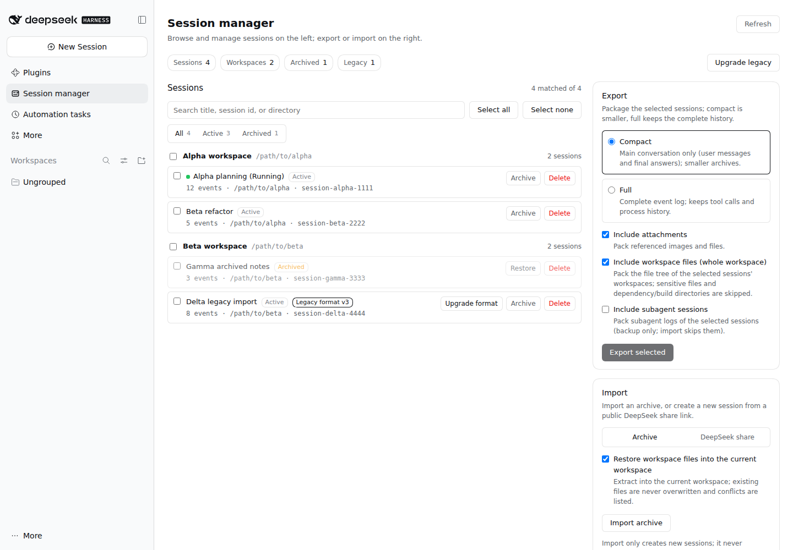

# dsh-session-kit

**Session manager, backup, and migration toolkit for [DeepSeek Harness](https://github.com/deepseek-ai/deepseek-harness).**

Version **0.12.0** · public beta · [中文说明](README.zh.md)

dsh-session-kit adds a **Session manager** panel and a <code>session_kit</code> agent
tool to DeepSeek Harness (DSH). It backs up a whole **workspace** (every session
plus the project files, collected once), exports selected conversations as
portable archives, imports them as new sessions on another machine or workspace,
manages archive state, upgrades old session logs through DSH's official
migration, and turns public DeepSeek share links into new local conversations.

It is built for people who migrate DSH between machines, keep local backups, or
want a smaller conversation-only copy of a long session — without touching DSH's
storage layout or rewriting session files by hand.

> The plugin is a plain ESM bundle. It declares no <code>@deepseek-ai/*</code> runtime
> dependency and reads every DSH capability through the composed service registry.

## Why dsh-session-kit

- **Back up a project, not guesses.** A workspace is DSH's project unit: one ZIP
  carries every session in that workspace and its file tree exactly once.
- **Move conversations between machines.** One ZIP carries sessions, their
  attachments and, optionally, the workspace trees they ran in. Import creates
  new sessions and never overwrites existing ones.
- **Keep a usable backup, not a byte dump.** *Compact* export keeps the visible
  conversation — your prompts, image/file blocks and each turn's final answer —
  and drops tool calls, reasoning and streaming deltas. The result is still a
  valid DSH session you can continue.
- **Manage sessions where they live.** Archive/unarchive, delete to a trash
  directory with strict path validation, restore or permanently purge a trash
  operation, or (explicitly) erase permanently.
- **Move a session to another workspace.** The copy is written under a new id,
  verified by reading it back, then the source is moved to the trash — the move
  stays reversible.
- **Upgrade old logs the official way.** Legacy sessions are upgraded through
  DSH's own migration chain; the old generation is retained and refusals are
  reported instead of forced.
- **Bring in a public DeepSeek share.** Paste a share link, pick a workspace, and
  the public conversation becomes a new local session.

## Features

### Browse, search, inspect

- Sidebar **Session manager** panel grouped by workspace; search by title, id,
  cwd or workspace; filter all / active / archived; sort by recently updated,
  created, title or directory; select one, many, or all. Long groups render 25
  rows at a time with a **show more** button, and the selection bar reports
  selected ids that the current filter hides.
- Archived sessions stay visible with an **archived** badge and a dimmed row.
- Subagent transcripts are hidden by default (they can be requested explicitly).
- Click a row for its **storage size** (all retained generations, lock files
  excluded), format status and archived state. The list itself never opens cold
  session logs.

### Workspace backup (recommended for projects)

- Choose one or more workspaces; each selected workspace is backed up as **its
  own ZIP** containing all its main sessions + the whole workspace tree. Files
  are collected once per workspace, not per session.
- The archive records `manifest.backup` with the workspace id, title and source
  path; only that root is packed. Sensitive/build/dependency paths and symlinks
  are excluded with the normal workspace rules.
- Restore through **Import → Archive → Target workspace**, which creates new
  sessions with the target cwd, attaches them to that workspace, and restores
  the files without overwriting existing files.
- This is the intended model when one workspace is one project. Session-level
  file derivation remains experimental for mixed workspaces.

### Export selected sessions

- **Compact** mode: conversation spine only. User messages, visible image/file
  blocks and the final assistant text of every turn, plus session-level config,
  request context and one title. Tool calls/results, reasoning, stream chunks,
  jobs, subagent and workspace events are dropped; sequence numbers are
  renumbered and the title's citations are remapped so DSH can replay and
  continue the log.
- **Compressed** mode: every event and tool call keeps its type, order and
  `seq`; streamed deltas are emptied and oversized strings are truncated with a
  visible marker (default 8 KiB per string, 16 KiB per event). Use it when full
  is too large and compact loses too much.
- **Full** mode: the complete event log and the attachments it references.
- One ZIP can contain many selected sessions; each session is its own folder
  with a per-session <code>meta.json</code>.
- **Optional workspace trees**: include the whole workspace of the selected
  conversations. Dependency/build directories, credential-shaped files and
  symlinks are excluded; oversized files and cap violations are skipped with
  warnings.
- Top-level <code>manifest.json</code> with sha256 checksums, plus an archive
  <code>README.md</code> that explains the layout.

### Import

- Accepts an archive produced by this plugin, a DSH built-in session-log export,
  or a bare <code>.jsonl</code> log.
- Always creates **new** sessions: it never modifies, overwrites or deletes an
  existing conversation.
- An archive exported by this plugin carries `archived` / `pinned` flags in
  `manifest.json` and each session `meta.json`; import re-applies them to the new
  id best-effort (a registry failure is a warning, not a rollback).
- Before writing, a **duplicate preflight** compares each source id with local
  sessions. Duplicates still import as new-id copies with a warning; enable
  **Skip duplicates** (or `?skipDuplicates=1`) to filter them out instead. If
  every session is filtered the import reports `no-session`.
- `POST /session-kit/import?progress=ndjson` streams one `session` line per
  committed session plus a final `done`/`error` line; the panel uses the normal
  JSON response.
- New session id and header; parent/seed lineage is dropped. Delivery markers and
  inherited end-seed markers are rewritten for the new owner; attachments are
  restored into the content-addressed store.
- Optional **workspace file restore** into the chosen directory. Path traversal,
  absolute paths and symlinks are rejected before writing; existing files are
  skipped with a warning.
- Each imported session is read back through the session query after the write as
  a post-write verification; a failure is reported per session.

### Manage: archive and delete

- **Archive / unarchive** a session or a batch. Archive state is durable in the
  workspace registry, so every DSH surface agrees; archived rows stay visible in
  this panel.
- **Delete is a move, not an erase.** The session directory and its
  <code>origin: 'subagent'</code> descendants move to
  <code>$DSH_HOME/session-kit-trash/&lt;timestamp&gt;/</code>. User-visible
  fork/seeded children are preserved. Live sessions and running agents are
  refused before anything moves; every backend session directory is validated
  (canonical name, canonical project directory, not a symlink) and a failed move
  rolls back.
- Each delete writes an `operation.json` manifest before the first move
  (per-session original directories, the derived sessions root, and the
  archived/pinned snapshots). Workspace membership, pins and archive state are
  cleaned afterwards; cleanup failures are logged rather than reported as a
  failed delete.

### Trash: restore and purge

Deletes stay recoverable until you purge them.

- **Trash card / `trash_list`.** Lists every operation under
  `$DSH_HOME/session-kit-trash/` with its session count, byte size, and
  restorable flag. Directories written by older releases (no manifest) are shown
  but marked *manifest missing* — they can only be purged or restored by hand.
- **Restore / `trash_restore`.** Moves each recorded session directory back to
  its original project directory, re-attaches it to that workspace, and replays
  the archived/pinned snapshot. A target that already exists is skipped, never
  overwritten; a path outside the recorded sessions root is refused. A partial
  restore keeps the operation (with the remaining sessions) for a later call.
- **Purge / `trash_purge`.** Permanently removes whole operation directories.
  Requires `confirm: true`; accepts explicit operation ids or `all`, optionally
  limited by `olderThanDays`. It never touches the attachment store and never
  removes a directory outside the trash root.

### Move a session to another workspace

- **Move card action / `move`.** Select sessions and choose **Move to workspace**
  (next to archive and delete). Pick the destination in the dialog.
- DSH binds a session to a workspace through the header's `cwd`, and that value
  cannot be re-labelled in place. The plugin therefore copies each session into
  the target workspace under a **new id**, verifies the copy by reading it back
  through the session query, attaches it there, and only then moves the source
  directory into the trash. A failed copy leaves the source untouched; a failed
  trash move keeps the copy and reports it.
- Live/running sessions, subagent transcripts and older-format logs are skipped
  before any write. Subagent transcripts are not copied (they travel with the
  source into the trash); attachment bytes are shared, not duplicated; archived
  and pinned state is replayed best-effort.
- The old id stops working after a move; restoring the trash operation brings the
  source and its old id back. The batch is per-session tolerant (max 100) and
  requires `confirm: true`.

### Attachment reference check

- The **Attachment check** card and `attachment_report` scan up to 300
  sessions read-only, resolve every image/file reference in the logs against the
  attachment provider's host path, and report references that are **missing** or
  **unverifiable** (no host path is exposed by the backend).
- `GET /session-kit/attachment-report?limit=&includeSubagents=1` accepts a
  positive `limit` (max 300). The response includes scanned/total sessions,
  truncation, reference counts and per-session missing entries.
- It never deletes, rewrites or repacks anything. This is deliberately not an
  orphan listing: the attachment store is append-only and exposes no
  enumeration/delete API in the supported surface.

### Experimental: related files on delete

This feature is marked **experimental** in the UI and requires a second
confirmation.

- Clicking a session loads a **best-effort** list of workspace files derived from
  its events: presented deliverables, tool result metadata, tool arguments and
  working-directory hints. Evidence is labelled strong or weak; files are
  grouped by session and individually selectable.
- Trash delete moves only the selected files into the operation's
  <code>&lt;trash&gt;/files/&lt;encoded-root&gt;/&lt;relative-path&gt;</code> tree
  with a <code>files-manifest.json</code>, then moves the session directories. A
  file failure rolls the moved files back before any session directory moves.
- **Permanent delete** is a separate opt-in mode with its own red confirmation.
  It validates every session directory and selected file first, then unlinks the
  files and removes the session directories. There is **no trash copy and no
  rollback**; failures report what was already erased.

The derivation is inherently approximate: shell redirections, PTC/script outputs
and files only mentioned in text cannot be discovered, and a file shared with
another session is affected too. Review the preview before confirming.

### Legacy format migration

- The list marks sessions stored in an older session format
  (<code>formatStatus</code>, <code>legacy</code>), including their stored
  generation.
- Single or batch upgrade runs through DSH's official persistence migration:
  <code>SessionPersistence.open(id, 'write')</code> triggers the prepare/publish
  path, the handle is closed immediately, and a second <code>stat</code> verifies
  the published generation. The plugin never decompresses, re-encodes or
  rewrites a session artifact itself.
- The released old generation stays on disk. If the official migration refuses a
  log (for example an unresolved tool call or an unsupported historical subagent
  descriptor), the source remains unchanged and the failure is reported with the
  official reason.

### DeepSeek share-link import

- Paste <code>https://chat.deepseek.com/share/&lt;id&gt;</code> or a bare share
  id, choose a target workspace, optionally set a title, and import.
- Only public content from <code>chat.deepseek.com</code> is fetched; arbitrary
  URLs are refused. Requests have a timeout and a response-size cap, and non-zero
  API codes / non-JSON responses fail loudly.
- The public conversation is normalized (requests, responses, thinking, search
  and opened-source fragments, citations) and converted into the same v4 session
  skeleton used by the standalone share importer, then imported as a new session
  in the chosen workspace. No arbitrary workspace file is fetched.

### Agent tool

The <code>session_kit</code> tool exposes the same operations to the model:

| Action | Purpose | Notes |
| --- | --- | --- |
| <code>list</code> | Summarize workspaces and sessions | archived rows are marked |
| <code>export</code> | Write one ZIP under the plugin's export directory | <code>mode: compact</code> / <code>compressed</code> / <code>full</code>, <code>sessionIds</code> or <code>all</code> |
| <code>export_workspace</code> | Write one ZIP per selected workspace | <code>workspaceIds</code> (max 20) or a single <code>workspaceId</code>; each ZIP carries all main sessions + that workspace tree |
| <code>import</code> | Import an archive file as new sessions | optional workspace file restore |
| <code>archive</code> / <code>unarchive</code> | Toggle the durable archive state | batch ids supported |
| <code>delete</code> | Move sessions to the trash | requires <code>confirm: true</code>; optional <code>removeFiles</code> with explicit <code>selectedFiles</code>; <code>permanent: true</code> erases irreversibly |
| <code>migrate</code> | Upgrade legacy logs through DSH's official migration | <code>sessionIds</code> or <code>all</code> (needs <code>confirm: true</code>) |
| <code>move</code> | Copy sessions into another workspace, then trash the sources | requires <code>confirm: true</code> and <code>workspaceId</code>; new ids; skips live/subagent/legacy |
| <code>trash_list</code> | List trash operations with size and restorable flag | read-only |
| <code>trash_restore</code> | Move an operation's sessions back into their workspace | <code>operationId</code>; optional <code>sessionIds</code> subset |
| <code>trash_purge</code> | Permanently erase trash operations | requires <code>confirm: true</code>; <code>operationIds</code> or <code>all</code>, optional <code>olderThanDays</code> |
| <code>files</code> | Preview derived related files for a delete | experimental, best effort |
| <code>detail</code> | Report storage size, format status and archived state | up to 100 explicit ids; read-only, no writes |
| <code>import_share</code> | Import a DeepSeek share link | <code>input</code>, optional <code>workspaceId</code> / <code>cwd</code> / <code>title</code> |
| <code>attachment_report</code> | Report missing/unverifiable attachment references | read-only; up to 300 sessions; optional <code>limit</code> |

Example prompts you can give the agent:

- "Export the current session in compact mode."
- "Import the archive at ~/Downloads/session-kit-backup.zip into this workspace."
- "Upgrade all legacy-format sessions."
- "Import this DeepSeek share link into the project workspace: https://chat.deepseek.com/share/…"

## Install

**Requirements:** DSH <code>0.2.1-rc.3</code> or newer, session format v4, Node 22+
for the plugin (the shipped DSH CLI requires Node 24.9+). The browser panel needs
a Web or Desktop deployment; a headless deployment still gets the
<code>session_kit</code> tool.

~~~bash
# from GitHub (recommended: pin a release tag)
dsh plugin --profile web add github:czr-chu/dsh-session-kit#v0.12.0

# or directly from a GitHub Release tarball
# dsh plugin --profile web add 'https://github.com/czr-chu/dsh-session-kit/releases/download/v0.12.0/dsh-session-kit-0.12.0.tgz'

# from a local checkout (iterating on the plugin)
dsh plugin --profile web add ~/src/dsh-session-kit

# verify the row was added
dsh plugin --profile web list --depth 0
~~~

Restart <code>dsh web</code> after installing, then refresh the page. The sidebar
gets a **Session manager** row under Plugins.

In the Desktop/Web **Plugins → Add plugin** dialog, enter either the GitHub
repository URL (`https://github.com/czr-chu/dsh-session-kit#v0.12.0`), the
Release `.tgz` URL, or an absolute local directory. The repository is public; no
GitHub token is needed for a Git install. See [docs/install.md](docs/install.md)
for the repository requirements and offline install.

The npm name <code>dsh-session-kit</code> already belongs to an unrelated
package on npm, so install this project from GitHub or from a Release tarball;
do not run <code>dsh plugin add dsh-session-kit</code> unless this project is
later published under a different name.

An incompatible DSH version is refused at install time through
<code>engines.dsh</code>.

## Quick start

1. **Open the panel.** After restarting <code>dsh web</code> and refreshing, click
   **Session manager** in the sidebar. Rows are grouped by workspace; use the
   search box and the all/active/archived filter.
2. **Back up one or more workspaces.** In **Workspace backup** tick the
   workspaces (or **Select all workspaces**) and click **Back up workspace**.
   Each workspace becomes its own ZIP with all its main sessions and its tree
   once; the panel reports every file and any per-workspace failure.
3. **Export selected sessions (optional).** Select conversations, choose
   **compact**, **compressed** or **full** in the Export card, and click **Export selected**.
   The browser downloads one ZIP; the agent tool writes it under
   <code>$DSH_HOME/session-kit/exports/</code> instead.
4. **Import an archive.** In the Import card choose **Archive**, pick a ZIP (or
   bare <code>.jsonl</code>), choose the **Target workspace**, enable
   workspace-file restore when restoring a backup, and click **Import archive**.
   Imported conversations appear as new sessions; nothing existing is overwritten.
5. **Manage.** Use the row actions to archive/unarchive or delete. Delete moves
   the session to the trash; the delete dialog also offers the experimental
   related-file selection and a separate permanent-erase confirmation. The
   **Trash** card at the bottom of the tools column lists delete operations and
   can restore or permanently purge them. **Move to workspace** copies the
   selected sessions into another workspace and moves the sources to the trash.
6. **Upgrade legacy rows.** A row with the legacy badge can be upgraded singly or
   in a batch through DSH's official migration; the old generation is kept.
7. **Import a DeepSeek share.** In the Import card choose the **DeepSeek share**
   tab, paste a share link or id, choose a workspace, and import.
8. **Or ask the agent.** The <code>session_kit</code> tool exposes the same
   operations (see the action table below).

## Archive layout

One ZIP contains a manifest, a restore README, per-session folders and optional
workspace trees:

~~~text
session-kit-<count>-sessions-<timestamp>.zip
├── manifest.json                         # kind/version, sessions, sha256, workspaces
├── README.md                             # restore instructions
├── sessions/<sessionId>/
│   ├── session.v4.jsonl                  # full mode
│   ├── session.compact.v4.jsonl          # compact mode
│   ├── session.compressed.v4.jsonl       # compressed mode
│   └── meta.json
├── attachments/
│   ├── media/<attachmentId>.<ext>
│   └── files/<prefix>/<digest>/<name>
└── workspaces/<encoded-workspace>/...    # optional whole workspace tree
~~~

The trash produced by delete is separate from archives:

~~~text
$DSH_HOME/session-kit-trash/<timestamp>/
├── operation.json                        # manifest: sessions, original dirs, archived/pinned
├── <encoded-session-id>/...              # moved session directory + subagent descendants
├── files/<encoded-workspace>/<relative>  # selected related files (experimental flow, optional)
└── files-manifest.json                   # original absolute paths, evidence, session ids (optional)
~~~

## Configuration

Plugin row config (<code>cordis.patch.yml</code> or the plugin settings row):

| Field | Default (bundle) | Meaning |
| --- | --- | --- |
| <code>maxImportBytes</code> | 512 MiB | Maximum archive upload size |
| <code>maxExportBytes</code> | 1 GiB | Maximum produced archive size |
| <code>includeAttachments</code> | <code>true</code> | Export referenced attachments by default |
| <code>includeWorkspaceFiles</code> | <code>true</code> (bundle) | Include whole workspace trees by default |
| <code>includeSubagents</code> | <code>false</code> | Export subagent transcripts by default |
| <code>restoreWorkspaceFiles</code> | <code>true</code> (bundle) | Restore archived workspace files on import by default |
| <code>workspaceExclude</code> | <code>[]</code> | Extra directory names / patterns to exclude |
| <code>workspaceMaxBytes</code> | unset | Optional byte cap for the workspace part |
| <code>trashDir</code> | <code>$DSH_HOME/session-kit-trash</code> | Where deleted sessions move |
| <code>defaultMode</code> | <code>compact</code> | Export mode used when the caller omits one: <code>full</code>, <code>compact</code> or <code>compressed</code> |

The bundle exports a standard-schema `Config`; unknown keys and wrong types
fail the plugin at startup rather than being silently defaulted. Batch limits:
up to 500 management ids per request, 100 ids for migration, workspace move,
file preview and session detail, 20 workspaces per backup batch, and 5000
selected files per delete.

## Security and privacy

- Exports contain **user content**: conversation text, referenced attachments and
  (optionally) workspace files. Review an archive before sharing it.
- Workspace collection excludes <code>.git</code>, <code>node_modules</code>,
  <code>.venv</code>, <code>venv</code>, <code>dist</code>, <code>build</code>,
  <code>.next</code>, <code>target</code>, <code>__pycache__</code>,
  <code>.cache</code>, <code>.pnpm-store</code>, <code>.yarn</code>,
  <code>.idea</code>, <code>.vscode</code> directories; <code>.env</code>,
  <code>.env.*</code>, <code>*.pem</code>, <code>*.key</code>, <code>*.p12</code>,
  <code>*.keystore</code>, <code>id_rsa*</code>, <code>id_ed25519*</code>,
  <code>.npmrc</code>, <code>.netrc</code>, <code>.git-credentials</code>,
  <code>credentials*</code>, <code>secrets*</code>, <code>.DS_Store</code> files
  and <code>.ssh</code>, <code>.aws</code>, <code>.gnupg</code>,
  <code>.config/gcloud</code> directories. Symlinks are not followed. DSH
  credentials, upload indexes, caches and telemetry identities are never read.
- Imports treat archives as untrusted: manifests and checksums are validated,
  workspace restore rejects traversal/absolute paths/symlinks, format-version
  mismatches and over-limit archives are refused, and existing sessions are never
  overwritten.
- Delete is a trash move with strict backend-location validation and rollback;
  permanent delete is opt-in, validated before erasing, and irreversible.
- Share import accepts only <code>chat.deepseek.com/share/&lt;id&gt;</code> links
  or bare share ids, never arbitrary URLs, with timeout and response-size caps.
- Deleting with related files is **experimental and best effort**. The derivation
  can miss files and can affect files shared with other sessions. Treat the
  preview as a hint, not a complete inventory.
- These protections reduce risk but cannot guarantee that every sensitive file
  in a workspace is undiscoverable. Keep backups and review exports.

More detail: [docs/security.md](docs/security.md) and the [privacy audit](docs/privacy.md).

## Compatibility

- DSH <code>0.2.1-rc.3</code> or newer; session format **v4**.
- Node.js 22+ for the plugin; the shipped DSH CLI requires Node 24.9+.
- Web and Desktop deployments get the panel; headless deployments get the agent
  tool.
- Import requires the archive's session format to match the running DSH; export
  in a matching version or migrate first.
- DSH public APIs are pre-stable; this plugin reads capabilities through
  <code>ctx.get(...)</code>, so it does not pin <code>@deepseek-ai/*</code>
  packages. A DSH upgrade may still require a plugin update.

## Known limitations

- **Compact export is lossy by design.** It keeps the visible conversation, not
  tool history, reasoning or runtime records; use full export for a byte-level
  backup.
- Subagent transcripts are never imported; imported sessions have no parent/seed
  lineage. Fork/seeded children hidden from a parent delete are kept as
  independent sessions.
- Workspace export currently packs the **whole** workspace tree (with the
  exclusions above). A per-session touched-files export is not implemented; the
  checked-file selection exists only for deletion.
- Backing up several workspaces produces one ZIP per workspace and may trigger a
  browser "allow multiple downloads" prompt; the batch is not atomic.
- Large workspaces are bounded by <code>maxExportBytes</code> /
  <code>workspaceMaxBytes</code>; oversized files and cap violations are skipped
  with warnings.
- Related-file derivation is approximate and marked experimental.
- A workspace move creates a new session id: links/bookmarks to the old id stop
  working until you restore the trashed source. Subagent transcripts are not
  copied and the move is not atomic across a batch.
- Permanent delete has no rollback and no trash copy.
- The official format migration can refuse a legacy log; the plugin reports the
  refusal and leaves the source unchanged.
- Share import needs network access to <code>chat.deepseek.com</code>; private or
  deleted shares fail, and only public content is available.
- Trash is not cleaned automatically. Use the Trash card / `trash_purge` (or
  delete old operation folders yourself) when the space is needed; a purge
  requires explicit confirmation and never removes attachments.

## Development and testing

The host half is plain ESM; the browser half is bundled from `src/client/` with the same closure-factory protocol the client module system loads. From a checkout of this repository:

~~~bash
# install the pinned build tooling and rebuild the committed client artifact
cd dsh-session-kit && npm ci
npm run build:client

# plugin-local tests (network-free; real-backend cases skip when unavailable)
npm run format:check
npm test

# full suite from the DSH repository root, including real persistence/replay checks
node --import tsx/esm --test dsh-session-kit/test/*.test.mjs
~~~

Expected result: **313 tests**, with 9 guarded real-backend cases skipped under
plain <code>node --test</code> (they run when the DSH checkout is available
through <code>tsx</code>). The suite covers session listing/reading, compact
building, workspace file collection and sensitive exclusions, archive
build/import (including zip-slip and sha256 checks, archived/pinned restore,
duplicate preflight, NDJSON progress), archive/trash/permanent
delete semantics, trash restore/purge, workspace move, multi-workspace backup,
attachment reference reporting, official format migration, and share-link
normalization/build/import against a real local JSONL backend where available.

Project docs: [architecture](docs/architecture.md) ·
[install and upgrade](docs/install.md) · [security](docs/security.md) ·
[plugin conformance](docs/plugin-conformance.md) · [workspace backup](docs/workspace-backup.md) ·
[self-assessment](docs/self-assessment.md) · [privacy audit](docs/privacy.md) ·
[feature matrix](docs/feature-matrix.md) · [roadmap](docs/roadmap.md) ·
[change documentation](docs/change-documentation.md) · [decision records](docs/decisions/README.md) ·
[market listing](docs/market-listing.md).

## Contributing and reporting security issues

- Issues and pull requests are welcome on
  [GitHub](https://github.com/czr-chu/dsh-session-kit). Please keep fixtures
  synthetic: no real session logs, workspace paths, credentials or screenshots.
- For a security issue, do not open a public issue with sensitive details.
  Report it privately through GitHub Security Advisories on the repository (or
  contact the maintainers listed there) and include a minimal reproduction.
- Before sending a change, run the test command above and keep compatibility
  notes (DSH version, session format) current.

## License

MIT. See [LICENSE](LICENSE). Portions of <code>lib/zip.js</code>,
<code>lib/format.js</code> and <code>lib/attachments.js</code> are derived from
[dsh-session-port](https://github.com/mswinandmc/dsh-session-port) (MIT); see
[NOTICE](NOTICE).