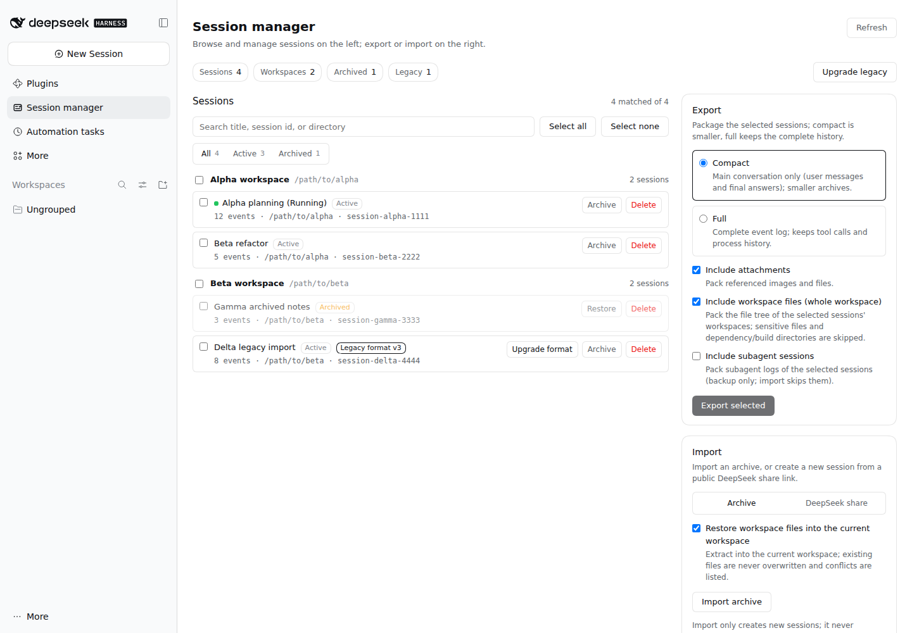

# dsh-session-kit

**DeepSeek Harness 的会话管理、备份与迁移工具包。**
Version **0.12.0** · 公开 beta · [English](README.md)

dsh-session-kit 为 DeepSeek Harness（DSH）增加一个 **会话管理（Session manager）**
面板和一个 <code>session_kit</code> agent 工具：按**工作区**备份整个项目（全部会话 +
整个工作区文件树，只打包一次）、导出选中会话为可迁移 ZIP、在另一台机器或另一个工作区
导入为新会话、管理归档状态、通过 DSH 官方迁移升级旧格式日志，并把 DeepSeek 公开分享链接
转成新的本地会话。

它面向需要在机器之间迁移 DSH、保留本地备份，或想得到一份更小的“纯对话”副本的用户，
不要求你手工改动 DSH 的存储布局或重写会话文件。

> 插件是纯 ESM bundle，不声明任何 <code>@deepseek-ai/*</code> 运行时依赖，
> 所有 DSH 能力都通过 composed service registry（<code>ctx.get(...)</code>）读取。

## 为什么需要它

- **按项目备份，而不是猜文件。** 工作区是 DSH 的项目单位：一个 ZIP 带上该工作区的全部会话
  和文件树，文件只出现一次。
- **在机器之间搬会话。** 一个 ZIP 带上会话、会话引用的附件，以及可选的整个工作区树；
  导入只新建会话，绝不覆盖已有会话。
- **拿到可用的备份，而不是字节堆。** *精简（compact）* 导出保留“看得见的对话”——
  你的提问、图片/文件块、每轮最终回答，丢掉工具调用、推理与流式增量；结果仍是
  可继续对话的合法 DSH 会话。
- **就地管理。** 归档/恢复；删除到回收站（严格校验落盘路径）；从回收站恢复或永久清理；
  或显式地永久删除。
- **把会话迁移到另一个工作区。** 复制成新 id、读回验证后，源会话移入回收站，
  整个迁移可回滚。
- **按官方方式升级旧日志。** 走 DSH 自己的迁移链，旧代际文件保留；官方拒绝时如实报告，
  不强行转换。
- **导入 DeepSeek 公开分享。** 粘贴分享链接、选择工作区，公开对话变成新的本地会话。

## 特性

### 浏览、搜索、检查

- 侧边栏 **Session manager** 面板按工作区分组；可按标题、id、cwd、工作区搜索；
  按全部 / 活动 / 已归档筛选；可按最近更新、创建时间、标题或目录排序；单选、多选或全选。
  长分组每次渲染 25 行，点**显示更多**逐批展开；选择栏会提示当前筛选之外的已选数量。
- 已归档会话仍在列表里显示，带 **归档** 徽标和暗色样式。
- 子代理会话默认隐藏（可显式请求包含）。
- 点击一行可查看 **存储大小**（含所有保留代际、排除 lock 文件）、格式状态与归档状态；
  列表本身不会打开冷会话日志。

### 工作区备份（项目推荐）

- 选择一个或多个工作区，每个工作区各自生成一个 ZIP，包含该工作区的**全部主会话 +
  整棵工作区文件树**；文件按工作区只收集一次，不按会话重复。
- 归档的 `manifest.backup` 记录工作区 id、标题和源路径；只打包该根目录，敏感/构建/依赖目录和
  符号链接按工作区规则排除。
- 通过 **Import → Archive → Target workspace** 恢复：以目标目录为 cwd 新建会话、挂到目标
  工作区，并安全恢复文件（不覆盖已有文件）。
- 一个工作区就是一个项目时，这是推荐模型；混合多项目工作区的 per-session 文件推导仍是实验性功能。

### 导出选中会话

- **精简（compact）**：只保留对话主线——用户消息、可见的图片/文件块、每轮最终助手文本，
  再加上会话级配置、请求上下文与一个标题事件。工具调用/结果、推理、stream chunk、任务、
  子代理与工作区事件全部丢弃；seq 重新编号、标题的 messageSeqs 重映射，保证 DSH 仍能
  replay 并继续该会话。
- **压缩（compressed）**：保留全部事件与工具调用的类型、顺序和 <code>seq</code>；
  流式增量置空，超长字符串截断并留下可见标记（默认单串 8 KiB、单事件 16 KiB）。
  适合「全量太大、精简又丢太多」的场景。
- **全量（full）**：完整事件日志及其引用的附件。
- 一个 ZIP 可包含多个被选会话，每个会话一个文件夹，并附带各自的 <code>meta.json</code>。
- **可选工作区树**：把所选会话所在的整个工作区一起打包。依赖/构建目录、
  凭据形状文件、符号链接都会被排除；超大文件和超限文件跳过并给出 warning。
- 顶层 <code>manifest.json</code>（sha256 校验）以及说明恢复方式的归档内
  <code>README.md</code>。

### 导入

- 支持本插件导出的 ZIP、DSH 内置会话日志导出、或裸 <code>.jsonl</code> 日志。
- 永远**新建**会话：不修改、不覆盖、不删除已有会话。
- 本插件导出的归档会在 `manifest.json` 与每个会话的 `meta.json` 中携带
  `archived` / `pinned`；导入时对新 id 尽力恢复（registry 失败只 warning，不回滚）。
- 写入前会做**重复预检**：把每个源 id 与本机会话比对。重复项默认仍以新 id 导入并
  warning；勾选**跳过重复项**（或 `?skipDuplicates=1`）则过滤掉。若全部被过滤，
  导入返回 `no-session`。
- `POST /session-kit/import?progress=ndjson` 会逐个会话输出 `session` 行，最后一行
  `done` 或 `error`；面板仍使用默认 JSON 响应。
- 生成新的会话 id 与 header；丢弃 parent/seed 血缘；投递水位与继承 end-seed 标记按
  新所有者改写；附件恢复到内容寻址附件库。
- 可选把归档里的工作区文件**恢复到目标目录**。写入前拒绝路径穿越、绝对路径、符号链接；
  已存在的文件跳过并 warning。
- 写入后会通过 session query 读回校验；失败按会话报告。

### 管理：归档与删除

- 单条或批量 **归档 / 恢复**。归档状态持久化在 workspace registry 中，所有 DSH 界面一致；
  已归档行仍在本面板可见。
- **删除是移动，不是抹除。** 会话目录及其 <code>origin: 'subagent'</code> 后代会移动到
  <code>$DSH_HOME/session-kit-trash/&lt;timestamp&gt;/</code>。用户可见的 fork/seeded
  子会话会保留。活动会话与运行中的 agent 在移动前被拒绝；所有后端会话目录都要通过校验
  （规范目录名、规范项目目录、非符号链接），移动失败会回滚。
- 每次删除都会在第一次移动前写入 `operation.json` 清单（每个会话的原目录、反推的会话根目录、
  删除前的归档/置顶快照）。之后清理工作区归属、置顶与归档状态；清理失败只记录日志，
  不会把已完成的删除报成失败。

### 回收站：恢复与永久清理

删除在清理前一直可恢复。

- **回收站卡片 / `trash_list`。** 列出 `$DSH_HOME/session-kit-trash/` 下每个操作的会话数、
  字节数与是否可恢复。旧版本写入的目录（没有清单）仍会显示，但标记为“缺少清单”，
  只能 purge 或手工还原。
- **恢复 / `trash_restore`。** 把清单记录的会话目录移回原项目目录、重新挂回该工作区，
  并按快照恢复归档/置顶状态。目标目录已存在时跳过，绝不覆盖；目标落在记录的会话根目录
  之外时拒绝。局部恢复会保留操作（只去掉已恢复的会话），便于稍后继续。
- **永久清理 / `trash_purge`。** 永久删除整个操作目录。需要 `confirm: true`；接受显式
  operation id 或 `all`，可选 `olderThanDays`。不会触碰附件存储，也不会删除回收站根目录
  之外的任何目录。

### 迁移：把会话移到另一个工作区

- **行内操作 / `move`。** 勾选会话后点 **迁移到工作区**（归档、删除之间的按钮），
  在对话框里选择目标工作区。
- DSH 通过日志头里的 `cwd` 决定会话属于哪个工作区，历史会话不能原地改归属。
  因此插件把每个会话**复制成新 id** 写入目标工作区，通过会话查询读回验证、
  挂回目标工作区，最后才把源目录移入回收站。复制失败时源会话保持原样；
  移入回收站失败时保留新副本并报告。
- 活动/运行中的会话、子代理转录、旧格式会话在写入前直接跳过。子代理转录不复制
  （随源目录进回收站）；附件按内容寻址共享，不复制字节；归档/置顶状态尽力重放。
- 迁移后旧 id 失效；恢复回收站操作会带回源会话和旧 id。批量逐条容错（上限 100），
  必须传 `confirm: true`。

### 附件引用检查

- **附件检查**卡片与 `attachment_report` 只读扫描最多 300 个会话，把日志里的
  图片/文件引用解析到附件后端的宿主路径，报告**缺失**或**无法验证**（后端不暴露
  宿主路径）的引用。
- `GET /session-kit/attachment-report?limit=&includeSubagents=1` 接受正整数
  `limit`（上限 300）；响应包含扫描/总会话数、是否截断、引用计数与逐会话缺失项。
- 它不删除、不改写、不重打包。这不是孤儿附件枚举：附件库只追加、受支持接口没有
  列表/删除 API。

### 实验性：删除时处理相关文件

该功能在 UI 中标注为 **实验性**，并要求二次确认。

- 点击会话会加载一份**尽力推导**的关联工作区文件列表：presented 交付物、工具结果元数据、
  工具参数、working-directory 线索。证据标注强/弱；文件按会话分组、逐文件勾选。
- 回收站删除只移动勾选的文件到本次操作的
  <code>&lt;trash&gt;/files/&lt;encoded-root&gt;/&lt;relative-path&gt;</code>，
  并写 <code>files-manifest.json</code>，然后才移动会话目录。文件阶段失败会先回滚已移动
  文件，会话目录完全不动。
- **永久删除**是独立的显式模式，有单独的红色二次确认。它会先校验所有会话目录与选中文件，
  再 unlink 文件、递归删除会话目录。**没有回收站副本，也没有回滚**；失败时会报告已经
  删除的内容。

文件推导本质上只是近似：shell 重定向、PTC/脚本产物、仅在文本中提到的文件无法发现，
与其他会话共享的文件也会被一并影响。请先看预览再确认。

### 旧格式升级

- 列表会标出旧格式会话（<code>formatStatus</code>、<code>legacy</code>），并给出其实际
  存储代际。
- 单条或批量升级走 DSH 官方持久化迁移：<code>SessionPersistence.open(id, 'write')</code>
  触发 prepare/publish，随后立即 close，再用第二次 <code>stat</code> 验证已发布的代际。
  插件**从不自行解压、重编码或重写**会话文件。
- 旧代际文件保留在磁盘上。若官方迁移拒绝某份日志（例如未闭合的 tool call、不支持的
  历史 subagent descriptor），源文件保持不变，失败原因按会话报告。

### DeepSeek 分享链接导入

- 粘贴 <code>https://chat.deepseek.com/share/&lt;id&gt;</code> 或裸分享 id，选择目标
  工作区、可选填标题，然后导入。
- 只抓取 <code>chat.deepseek.com</code> 上的公开分享内容，拒绝任意 URL；请求有超时与
  响应大小上限，API code 非 0 或非 JSON 会明确失败。
- 公开对话会被规范化（REQUEST / RESPONSE / THINK / TOOL_SEARCH / TOOL_OPEN /
  citation），转换成与独立分享导入器相同的 v4 事件骨架，然后作为所选工作区里的新会话导入。
  不会抓取任意工作区文件。

### Agent 工具

<code>session_kit</code> 工具把同样的能力暴露给模型：

| Action | 用途 | 说明 |
| --- | --- | --- |
| <code>list</code> | 汇总工作区与会话 | 已归档行会标记 |
| <code>export</code> | 在插件导出目录写一个 ZIP | <code>mode: compact</code> / <code>compressed</code> / <code>full</code>，<code>sessionIds</code> 或 <code>all</code> |
| <code>export_workspace</code> | 为每个选中的工作区各写一个 ZIP | <code>workspaceIds</code>（最多 20 个）或单个 <code>workspaceId</code>；每个 ZIP 含该工作区全部主会话与整棵树 |
| <code>import</code> | 把归档文件导入为新会话 | 可选恢复工作区文件 |
| <code>archive</code> / <code>unarchive</code> | 切换持久归档状态 | 支持批量 id |
| <code>delete</code> | 把会话移入回收站 | 需要 <code>confirm: true</code>；可选 <code>removeFiles</code> + 显式 <code>selectedFiles</code>；<code>permanent: true</code> 不可恢复 |
| <code>migrate</code> | 通过 DSH 官方迁移升级旧日志 | <code>sessionIds</code> 或 <code>all</code>（需 <code>confirm: true</code>） |
| <code>move</code> | 把会话复制到另一个工作区，再把源会话移入回收站 | 需要 <code>confirm: true</code> 与 <code>workspaceId</code>；产生新 id；跳过活动/子代理/旧格式 |
| <code>trash_list</code> | 列出回收站操作、大小与能否恢复 | 只读 |
| <code>trash_restore</code> | 把操作的会话移回工作区 | <code>operationId</code>；可选 <code>sessionIds</code> 子集 |
| <code>trash_purge</code> | 永久删除回收站操作 | 需要 <code>confirm: true</code>；<code>operationIds</code> 或 <code>all</code>，可选 <code>olderThanDays</code> |
| <code>files</code> | 预览删除会涉及的文件 | 实验性、尽力而为 |
| <code>detail</code> | 报告存储大小、格式状态与归档状态 | 最多 100 个显式 id；只读，不写任何数据 |
| <code>import_share</code> | 导入 DeepSeek 分享链接 | <code>input</code>，可选 <code>workspaceId</code> / <code>cwd</code> / <code>title</code> |
| <code>attachment_report</code> | 报告缺失/无法验证的附件引用 | 只读；最多 300 个会话；可选 <code>limit</code> |

可以直接对 agent 说：

- “把当前会话用精简模式导出。”
- “把 ~/Downloads/session-kit-backup.zip 导入到当前工作区。”
- “把所有旧格式会话升级一下。”
- “把这个 DeepSeek 分享链接导入到项目工作区：https://chat.deepseek.com/share/…”

## 安装

**要求：** DSH <code>0.2.1-rc.3</code> 或更新；会话格式 v4；插件本身需要 Node 22+
（DSH CLI 需要 Node 24.9+）。浏览器面板需要 Web 或 Desktop 部署；headless 部署仍可使用
<code>session_kit</code> 工具。

~~~bash
# 从 GitHub 安装（建议固定 release tag）
dsh plugin --profile web add github:czr-chu/dsh-session-kit#v0.12.0

# 或直接从 GitHub Release 的 tgz 安装
# dsh plugin --profile web add 'https://github.com/czr-chu/dsh-session-kit/releases/download/v0.12.0/dsh-session-kit-0.12.0.tgz'

# 从本地 checkout 安装（便于迭代）
dsh plugin --profile web add ~/src/dsh-session-kit

# 确认安装行
dsh plugin --profile web list --depth 0
~~~

安装后重启 <code>dsh web</code> 并刷新页面，侧边栏“插件”下会出现 **Session manager**
一行。

桌面版/Web 的 **插件 → 添加插件** 对话框可直接输入 GitHub 仓库地址
（`https://github.com/czr-chu/dsh-session-kit#v0.12.0`）、Release 的 `.tgz`
直链，或绝对本地目录。仓库是公开的，Git 安装不需要 GitHub token；完整说明见
[docs/install.md](docs/install.md)。

npm 上的 <code>dsh-session-kit</code> 已被另一个无关项目占用，因此请从 GitHub
或 Release 的 tgz 安装；除非本项目以后换用其他 npm 包名发布，否则不要执行
<code>dsh plugin add dsh-session-kit</code>。

DSH 版本不满足时会通过 <code>engines.dsh</code> 在安装阶段被拒绝。

## 快速开始

1. **打开面板。** 重启 <code>dsh web</code> 并刷新页面后，点侧边栏 **Session manager**。
   列表按工作区分组，可用搜索框和全部/活动/已归档筛选。
2. **备份一个或多个工作区。** 在 **Workspace backup** 卡片勾选工作区（或**全选工作区**），
   点 **Back up workspace**。每个工作区各自一个 ZIP，包含其全部主会话与整棵文件树；
   面板会逐条报告文件名与每个工作区的失败。
3. **导出选中会话（可选）。** 勾选会话，在 Export 卡片选择 **精简**、**压缩** 或 **全量**，点
   **Export selected**；浏览器会下载 ZIP（agent 工具则写到
   <code>$DSH_HOME/session-kit/exports/</code>）。
4. **导入会话包。** 在 Import 卡片切到 **Archive**，选择 ZIP 或裸 <code>.jsonl</code>，
   选择 **Target workspace**；恢复工作区备份时启用文件恢复，点 **Import archive**。
   导入的对话会成为新会话，不会覆盖已有会话。
5. **管理。** 用行内操作归档/恢复或删除。删除会移入回收站；删除对话框同时提供实验性的
   相关文件选择，以及独立的永久删除二次确认。工具列底部的**回收站**卡片列出删除操作，
   可恢复或永久清理。**迁移到工作区**会把选中会话复制到另一个工作区，并把源会话
   移入回收站。
6. **升级旧格式。** 带旧格式徽标的行可以单条或批量通过 DSH 官方迁移升级，旧代际文件保留。
7. **导入 DeepSeek 分享。** 在 Import 卡片切到 **DeepSeek share**，粘贴链接或 id，
   选择工作区后导入。
8. **或者直接让 agent 做。** <code>session_kit</code> 工具暴露同样的操作（见下方 action 表）。

## 包格式

一个 ZIP 包含 manifest、恢复说明、每会话文件夹以及可选的工作区树：

~~~text
session-kit-<count>-sessions-<timestamp>.zip
├── manifest.json                         # kind/version、sessions、sha256、workspaces
├── README.md                             # 恢复说明
├── sessions/<sessionId>/
│   ├── session.v4.jsonl                  # 全量模式
│   ├── session.compact.v4.jsonl          # 精简模式
│   └── meta.json
├── attachments/
│   ├── media/<attachmentId>.<ext>
│   └── files/<prefix>/<digest>/<name>
└── workspaces/<encoded-workspace>/...    # 可选：整棵工作区树
~~~

删除产生的回收站目录与归档无关：

~~~text
$DSH_HOME/session-kit-trash/<timestamp>/
├── operation.json                        # 清单：会话、原目录、归档/置顶快照
├── <encoded-session-id>/...              # 被移动的会话目录（含 subagent 后代）
├── files/<encoded-workspace>/<relative>  # 选中的相关文件（实验性流程，可选）
└── files-manifest.json                   # 原始绝对路径、证据、会话 id（可选）
~~~

## 配置

插件行配置（<code>cordis.patch.yml</code> 或插件设置行）：

| 字段 | bundle 默认值 | 含义 |
| --- | --- | --- |
| <code>maxImportBytes</code> | 512 MiB | 单次导入归档大小上限 |
| <code>maxExportBytes</code> | 1 GiB | 单次导出归档大小上限 |
| <code>includeAttachments</code> | <code>true</code> | 默认导出引用的附件 |
| <code>includeWorkspaceFiles</code> | <code>true</code>（bundle） | 默认整树导出工作区文件 |
| <code>includeSubagents</code> | <code>false</code> | 默认是否导出子代理日志 |
| <code>restoreWorkspaceFiles</code> | <code>true</code>（bundle） | 默认在导入时恢复工作区文件 |
| <code>workspaceExclude</code> | <code>[]</code> | 追加排除的目录名/模式 |
| <code>workspaceMaxBytes</code> | 未设置 | 可选的工区部分字节上限 |
| <code>trashDir</code> | <code>$DSH_HOME/session-kit-trash</code> | 删除会话移动到的目录 |
| <code>defaultMode</code> | <code>compact</code> | 调用方未指定时使用的导出模式：<code>full</code>、<code>compact</code> 或 <code>compressed</code> |

插件导出标准 schema 的 `Config`：未知 key 或类型错误会在启动时直接失败，而不是静默回退默认值。
批量上限：管理操作每请求最多 500 个 id，格式迁移/工作区迁移/文件预览/会话详情 100 个 id，
单次工作区备份最多 20 个工作区，
单次删除最多勾选 5000 个文件。

## 安全与隐私

- 导出内容属于**用户内容**：对话文本、引用的附件，以及可选的工作区文件。分享归档前请先检查。
- 工作区收集会排除 <code>.git</code>、<code>node_modules</code>、<code>.venv</code>、
  <code>venv</code>、<code>dist</code>、<code>build</code>、<code>.next</code>、
  <code>target</code>、<code>__pycache__</code>、<code>.cache</code>、
  <code>.pnpm-store</code>、<code>.yarn</code>、<code>.idea</code>、
  <code>.vscode</code> 目录；<code>.env</code>、<code>.env.*</code>、
  <code>*.pem</code>、<code>*.key</code>、<code>*.p12</code>、<code>*.keystore</code>、
  <code>id_rsa*</code>、<code>id_ed25519*</code>、<code>.npmrc</code>、
  <code>.netrc</code>、<code>.git-credentials</code>、<code>credentials*</code>、
  <code>secrets*</code>、<code>.DS_Store</code> 文件，以及 <code>.ssh</code>、
  <code>.aws</code>、<code>.gnupg</code>、<code>.config/gcloud</code> 目录；
  符号链接不跟随。DSH 凭据、上传索引、缓存与遥测身份永远不会被读取。
- 导入把归档视为不可信输入：校验 manifest 与校验和；工作区恢复拒绝路径穿越、绝对路径与
  符号链接；拒绝格式版本不一致和超限归档；绝不覆盖已有会话。
- 删除是带严格后端位置校验与回滚的回收站移动；永久删除必须显式开启、先校验后擦除，
  且不可恢复。
- 分享导入只接受 <code>chat.deepseek.com/share/&lt;id&gt;</code> 或裸分享 id，
  永不抓取任意 URL，并有超时与响应大小上限。
- 删除时处理相关文件是**实验性、尽力而为**：推导可能漏文件，也可能影响与其他会话共享的
  文件。请把预览当作线索，而不是完整清单。
- 这些保护能降低风险，但无法保证工作区里每一个敏感文件都不会被发现。请保留备份并检查导出。

更多细节见 [docs/security.md](docs/security.md) and [docs/privacy.md](docs/security.md)。

## 兼容性

- DSH <code>0.2.1-rc.3</code> 或更新；会话格式 **v4**。
- 插件需要 Node.js 22+；DSH CLI 需要 Node 24.9+。
- Web 与 Desktop 部署有面板；headless 部署只有 agent 工具。
- 导入要求归档的会话格式与当前 DSH 一致；请在匹配版本导出或先升级/迁移。
- DSH 公开 API 仍处于 pre-stable；插件通过 <code>ctx.get(...)</code> 读取能力，
  不固定依赖 <code>@deepseek-ai/*</code> 包。DSH 升级后插件仍可能需要更新。

## 已知限制

- **精简导出按设计有损**：只保留可见对话，不保留工具历史、推理或运行时记录；
  需要字节级备份请用全量导出。
- 子代理日志永远不会被导入；导入的会话没有 parent/seed 血缘。删除父会话时保留下来的
  fork/seeded 子会话会变成独立会话。
- 工作区导出目前打包**整棵**工作区树（带上述排除项）；尚未实现按会话只导出 touched files，
  逐文件勾选只存在于删除流程。
- 一次备份多个工作区会产生多个 ZIP，浏览器可能弹出“允许多个下载”的提示；批量不是原子的。
- 大工作区受 <code>maxExportBytes</code> / <code>workspaceMaxBytes</code> 限制；
  超大文件与超限内容会跳过并 warning。
- 相关文件推导是近似结果，且标注为实验性。
- 工作区迁移会产生新会话 id：旧 id 的链接/书签会失效，直到从回收站恢复源会话；
  子代理转录不复制，批量迁移也不是原子的。
- 永久删除没有回滚，也没有回收站副本。
- 官方格式迁移可能拒绝某份旧日志；插件会报告拒绝原因并保持源文件不变。
- 分享导入需要访问 <code>chat.deepseek.com</code>；私有或已删除的分享会失败，
  只能获取公开内容。
- 回收站不会自动清理；需要空间时用回收站卡片 / `trash_purge`（或自行删除旧操作目录）。
  永久清理必须显式确认，且不会删除附件。

## 开发与测试

宿主半是纯 ESM；浏览器半由 `src/client/` 经 tsdown + CSS Modules 构建成
提交的 `lib/client.js`。在仓库 checkout 下：

~~~bash
# 安装固定版本构建工具并重建已提交的客户端产物
cd dsh-session-kit && npm ci
npm run build:client

# 插件自身测试（不联网；真实后端用例在不可用时自动 skip）
npm run format:check
npm test

# 从 DSH 仓库根运行完整套件，包含真实持久化/replay 校验
node --import tsx/esm --test dsh-session-kit/test/*.test.mjs
~~~

预期：**313 个测试**，其中 9 个真实后端用例在纯 <code>node --test</code> 下 skip
（在通过 <code>tsx</code> 使用 DSH checkout 时会运行）。覆盖会话列表/读取、
compact 构建、工作区文件收集与敏感排除、归档构建/导入（含 zip-slip 与 sha256 校验）、
归档/回收站/永久删除语义、工作区迁移、多工作区备份、官方格式迁移，以及分享链接的规范化/构建/导入
（可用时对真实本地 JSONL 后端验证）。

项目文档：[插件规范符合性](docs/plugin-conformance.md) · [工作区备份](docs/workspace-backup.md) · [隐私审计](docs/privacy.md) · [架构](docs/architecture.md) · [安装与升级](docs/install.md) ·
[安全](docs/security.md) · [变更文档规范](docs/change-documentation.md) · [决策记录](docs/decisions/README.md)。

## 贡献与安全报告

- 欢迎在 [GitHub](https://github.com/czr-chu/dsh-session-kit) 提 Issue 或 PR。
  请保持 fixture 为合成数据：不要提交真实会话日志、工作区路径、凭据或截图。
- 安全漏洞请不要带敏感细节开公开 Issue。请通过仓库的 GitHub Security Advisories
  私下报告（或联系仓库列出的维护者），并提供最小复现。
- 提交改动前请运行上面的测试命令，并保持兼容性说明（DSH 版本、会话格式）为最新。

## 许可

MIT，见 [LICENSE](LICENSE)。<code>lib/zip.js</code>、<code>lib/format.js</code>、
<code>lib/attachments.js</code> 的部分代码衍生自
[dsh-session-port](https://github.com/mswinandmc/dsh-session-port)（MIT），
见 [NOTICE](NOTICE)。
